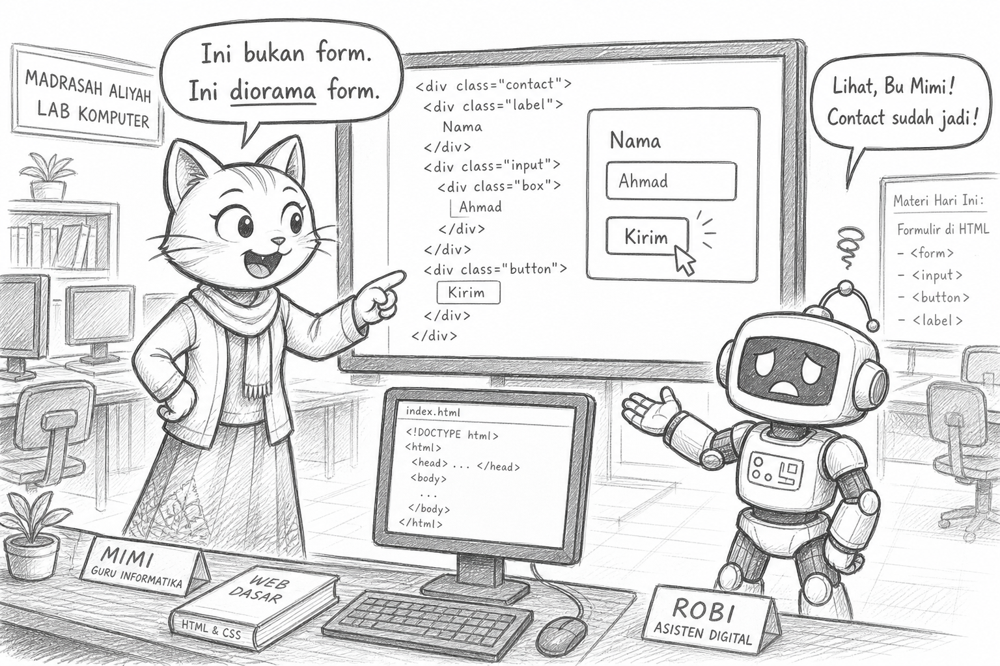
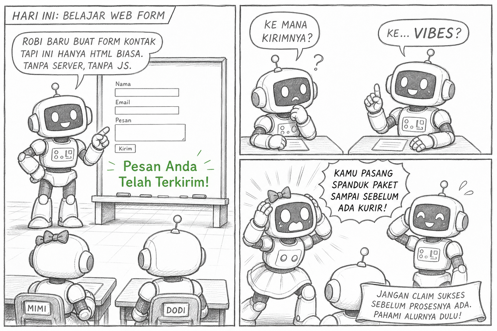
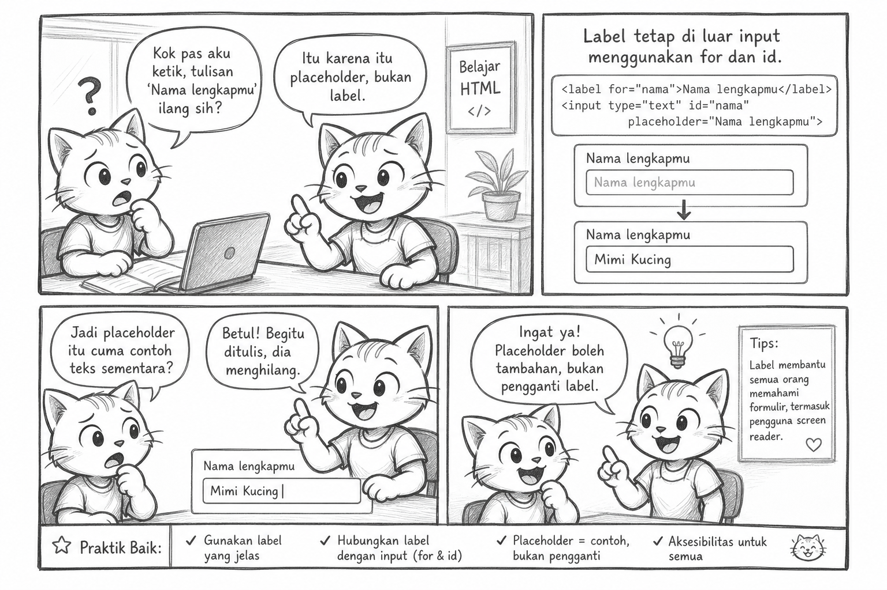
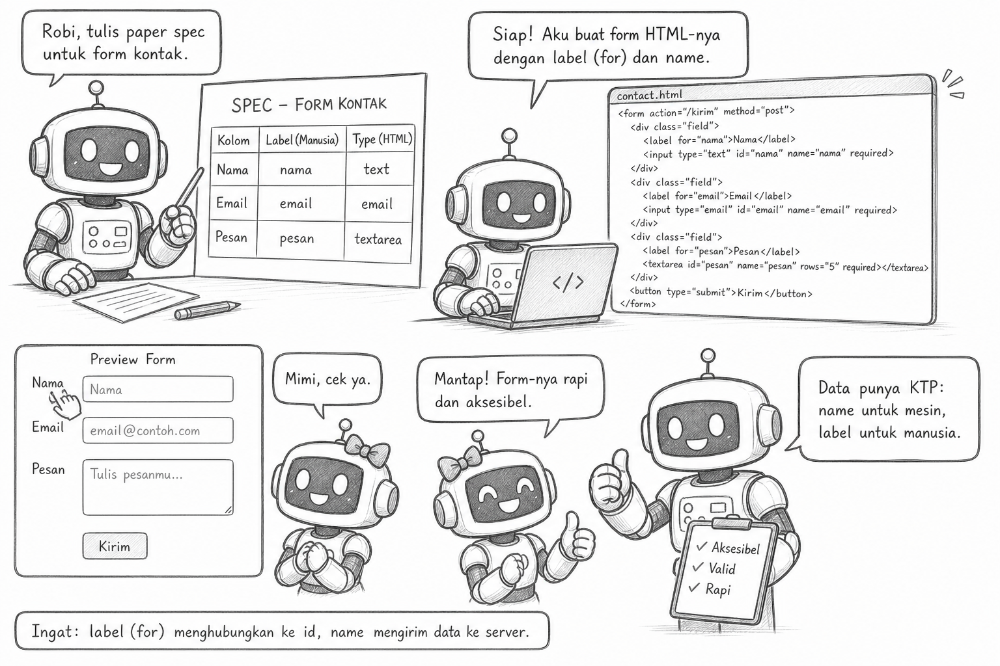

# Bacaan Pendamping — X-S1-P11  
## Mimi & Robi: Kotak Cantik yang Anonim, & Godaan “Pesan Terkirim!” Palsu

| Field | Isi |
|-------|-----|
| Kode | X-S1-P11 — Form HTML |
| Pertemuan | **11 / 34** · Basis **4JP** |
| Status | Naskah humor · istilah penuh · **4 sketch khusus Form HTML** |
| Nada | POV Mimi, Gen Z, **plot twist** |

**Handout:** [X-S1-P11_form-html_siswa.md](./X-S1-P11_form-html_siswa.md)  
**Modul:** [X-S1-P11 …](../../../base-4jp/kelas-x/semester-1/X-S1-P11_form-html.md)

---

Halo. Mimi.

Robi punya section `#kontak` (P10). Dia bangga.

> “Sudah ada kotak. Sudah ada tulisan Nama. Sudah ada tombol Kirim. Profesional.”

Aku klik. Tidak ada `<form>`. Tidak ada `name`. “Nama” cuma teks di samping `div`.

> “Ini bukan form. Ini diorama form.”

Antenna goyang. Dia belum siap dituduh diorama.



*** Diorama adalah pemandangan atau adegan miniatur tiga dimensi yang dirancang untuk menggambarkan situasi nyata, peristiwa sejarah, atau latar fiktif. ***

---

## Learning Compass

| Arah | Hari ini |
|------|----------|
| Tujuan | Form = menamai & mengumpulkan **input sebagai data** |
| Peranmu | Spek 2–4 field → `label` + `name` → peer cek |
| Bukan | Backend · “email benaran sampai” · validasi JS penuh |

```text
FORM PALSU VS SUNGGUHAN  →  LIHAT name  →  TRAP  →  SPEK FIELD  →  BUILD
```

---

## Adegan 1 — Flashback jaguar

Aku:

> “Ingat P02? Mesin ikut **input** yang kau beri — bukan niat di kepala.”

Robi:

> “Jaguar.”

> “Nah. Form tanpa `name` = jaguar tanpa keyword. Data datang… anonim. Mesin nanti (JS/server) bingung: ini nama atau kode rahasia?”

Plot twist: pelajaran jaguar kembali — kali ini di `<input>`.

---

## Plot twist #1 — “Pesan terkirim!”

Robi tambah teks hijau besar setelah tombol:

> **Pesan Anda telah terkirim!**

Padahal tidak ada server. Tidak ada JS. Hanya harapan dan CSS.

Teman:

> “Aku kirim. Ke mana?”

Robi:

> “Ke… vibes?”

Aku:

> **KRISIS!** (versi kantor pos.)  
> “Kamu pasang spanduk ‘paket sampai’ sebelum ada kurir. Itu bukan UX. Itu tipu-tipu.”

Yang jujur: *Struktur form siap. Pemrosesan otomatis belum diajarkan.*

Lulus etika > lulus drama.



---

## Adegan 2 — Placeholder tipu daya

Dia pakai hanya:

```html
<input placeholder="Nama lengkapmu" />
```

Ketik — placeholder hilang. Teman yang butuh petunjuk… petunjuknya kabur.

**`label`** tetap di luar, terhubung dengan `for` + `id`. Placeholder boleh tambahan — bukan pengganti.



---

## Concept — data punya KTP

| Istilah | Arti manusia |
|---------|----------------|
| Form | Wadah minta data |
| Field | Satu kolom data |
| `label` | Nama yang dibaca manusia |
| `name` | Nama yang dibaca mesin / pemroses |
| `type` | Jenis kotak (`text`, `email`, …) |
| Submit | “Ini dia isiannya” |

Robi spek di kertas dulu:

| Label | name | type |
|-------|------|------|
| Nama | nama | text |
| Email | email | email |
| Pesan | pesan | textarea |

Baru ngetik. Baru bisa jelaskan. Bukan robocopy form AI 20 kolom “Newsletter + Fax + Blood type.”



---

## Adegan 3 — Peer

Teman:

> “`for` cocok `id`. `name` ada. Catatan jujur ada. Tombol tidak berbohong.”

Robi hampir bilang “keren.”

Aku:

> “Bilang: **kriteria penerimaan form terpenuhi**.”

Dia mengangguk. Menyimpan energi lebay untuk nama `id` (kebiasaan).

---

## Reflect

| Pertemuan | Badge tidak resmi |
|-----------|-------------------|
| 10 | Halaman yang punya peta |
| **11** | Form yang punya nama (data) |

Besok (P12): review static vs spek — temankan checklist, bukan perasaan “sudah bagus.”

---

## Exit

1. Kenapa `name` penting: …  
2. Fieldku (label + `name`): …  
3. Godaan yang kutolak: …

Satu line:

> **Kotak tanpa nama bukan data.**  
> **Tombol Kirim tanpa kejujuran bukan fitur — itu iklan palsu.**

— **Mimi** 🐾  
*(Robi menulis di `<small>`: `belum-ada-kurir-jangan-klaim-sampai` — lebay, tapi jujur.)*

- Ilustrasi: `assets/mimi-robi/p11-01` … `p11-04` (`.jpg`)
