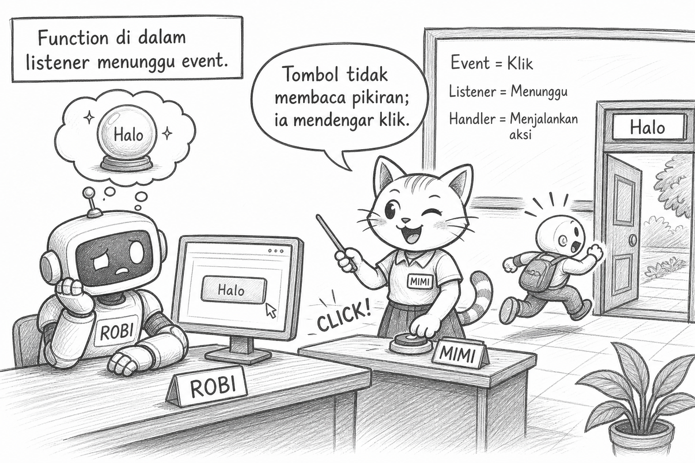

# Bacaan Pendamping — X-S1-P21
## Mimi & Robi: Halaman yang Akhirnya Mendengar, Alamat `id` yang Nyasar, & Tombol yang Tidak Boleh Telepati

| Field | Isi |
|---|---|
| Kode | X-S1-P21 — DOM & Event Pertama |
| Pertemuan | **21 / 34** · Basis **4JP** |
| Status | Naskah humor · **3 sketch khusus DOM & Event** |

**Handout:** [X-S1-P21_dom-event-pertama_siswa.md](./X-S1-P21_dom-event-pertama_siswa.md)

---

Halo. Mimi.

Setelah delapan pertemuan JavaScript di konsol, Robi menatap halaman HTML.

> “Sekarang aku boleh menyentuh halaman?”

> “Boleh. Karena kamu sudah tahu nilai, kondisi, loop, function, dan cara membaca error. Kita mulai kecil: satu alamat, satu klik, satu perubahan.”

```html
<p id="pesan">Belum diklik.</p>
<button id="tombolSapa" type="button">Klik</button>
```


## Plot twist #1 — alamat tanpa pagar

Robi menulis:

```javascript
document.getElementById("#pesan");
```

Hasilnya `null`.

> “Alamatnya lengkap, ada pagarnya!”

> “Pagar `#` dipakai CSS. `getElementById` sudah tahu ia mencari id. Beri nama saja.”

```javascript
const pesan = document.getElementById("pesan");
```


## Plot twist #2 — tombol bukan cenayang

```javascript
tombolSapa.addEventListener("click", function () {
  pesan.textContent = "Halo";
});
```

Robi menunggu perubahan sebelum klik.

> “Function di dalam listener menunggu event. Tombol tidak membaca pikiran; ia mendengar klik.”



## Trace

```text
sebelum klik → "Belum diklik."
klik → listener berjalan
textContent baru → "Halo"
konsol → bukti event
```

## Exit

1. Mengapa id harus tepat?  
2. Apa yang memicu listener?  
3. Apa beda `textContent` dan CSS?

> **Interaksi kecil yang dipahami lebih jujur daripada halaman ramai yang tidak bisa dijelaskan.**

— **Mimi** 🐾

- Ilustrasi: `assets/mimi-robi/p21-01` … `p21-03` (`.jpg`)
