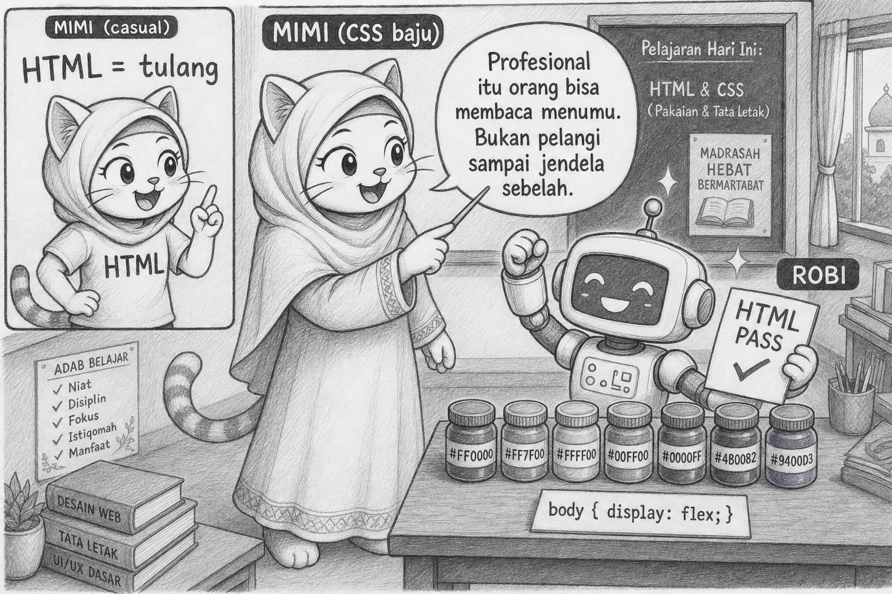
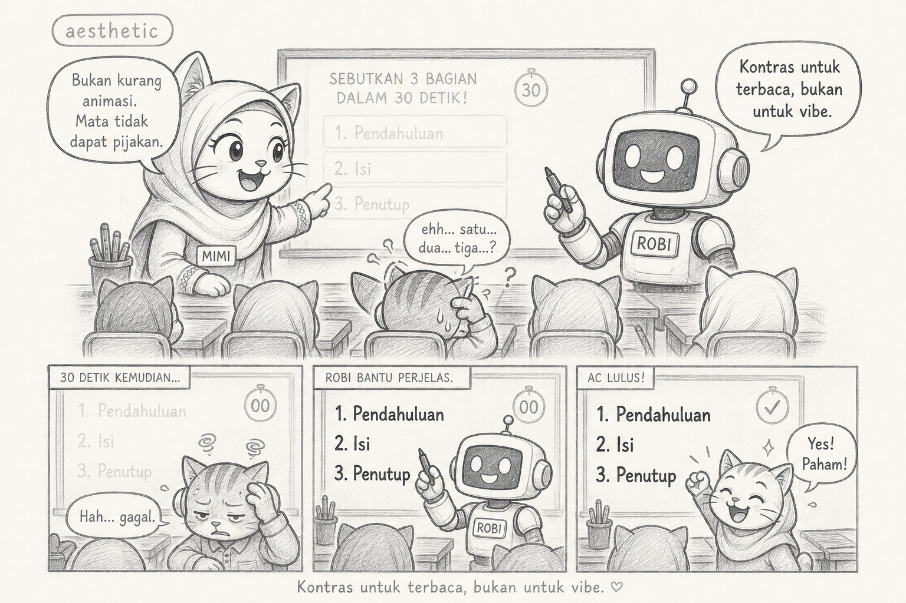

# Bacaan Pendamping — X-S1-P25
## Mimi & Robi: Cat yang Melayani Mata, Baris sepanjang Langit, & Flex yang Mengira Ia Arsitek

| Field | Isi |
|---|---|
| Kode | X-S1-P25 — CSS Keterbacaan |
| Pertemuan | **25 / 34** · Basis **4JP** |
| Status | Naskah humor · **4 sketch khusus CSS Keterbacaan** · Mimi baju syari (metafora CSS) |

**Handout:** [X-S1-P25_project-s1-css_siswa.md](./X-S1-P25_project-s1-css_siswa.md)

---

Halo. Mimi.

*(Mulai fase project CSS: bajuku lebih rapi/syari. Tulang tetap kucing. Presentasi berubah — seperti HTML yang tidak diganti hanya karena CSS.)*

HTML Robi lulus P24. Ia merayakan dengan tujuh warna dan `display: flex` pada `body`.

> “Sekarang profesional.”

Mata saya berjalan ke tepi monitor, pulang, lalu menyerah.

> “Profesional itu orang bisa membaca menumu. Bukan pelangi yang melebarkan baris sampai ke jendela sebelah.”

## Learning Compass

| Arah | Hari ini |
|---|---|
| Tujuan | Lebar, jarak, hierarki, kontras |
| Bukan | Template · JS fitur · bongkar HTML |

## Adegan 1 — 40rem

Satu baris CSS: `max-width: 40rem; margin: 0 auto`.

Halaman tiba-tiba punya bahu. Robi kaget.

> “Cuma itu?”

> “Seringnya iya. Keterbacaan itu sering properti yang membosankan. Yang ramai justru yang merusak.”

## Plot twist #1 — flex arsitek dadakan

`body { display: flex }` membuat `header` dan `footer` berdempet samping.

> “Tutorialku pakai flex.”

> “Tutorial itu punya masalah berbeda. Dokumenmu sudah punya landmark. Flex untuk satu baris nav, bukan untuk membongkar rumah.”

## Plot twist #2 — kontras “aesthetic”

Teks abu muda di latar krem. Dari kursi belakang: tidak terbaca.

Peer 30 detik gagal menyebut tiga section. Bukan karena kurang animasi. Karena mata tidak dapat pijakan.

Robi menggelapkan teks. Lulus AC. Antenna kecewa secara estetika, bangga secara spek.

## Reflect

Cat yang baik tidak mengganti dinding. P26 menyalakan satu saklar. Jangan renovasi semalam.

## Exit

1. Properti mana yang paling menolong bacaanmu?  
2. Apa yang kamu *tidak* pakai, dan mengapa?  
3. HTML masih utuh?

> **CSS yang adil membuat spek mudah dibaca, bukan sulit dikenali.**

— **Mimi** 🐾

- Ilustrasi: `assets/mimi-robi/p25-01` … `p25-04` (`.jpg`)
- Referensi baju CSS: `assets/mimi-robi/mimi-css-syari-referensi.png`
