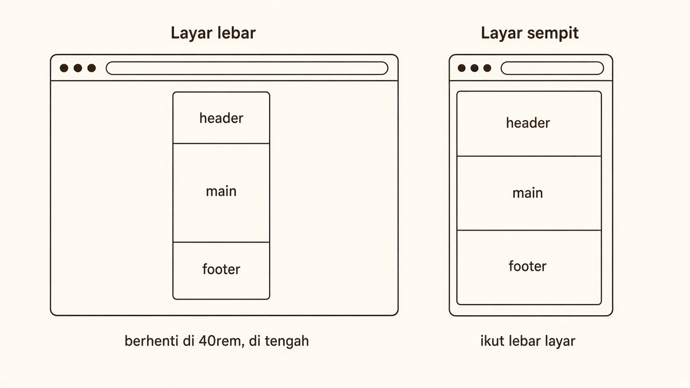
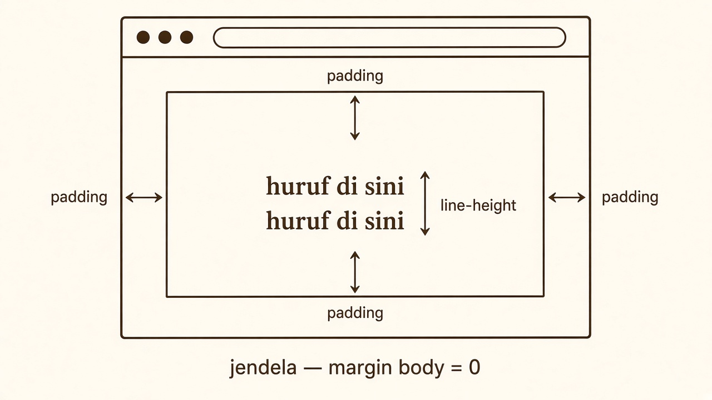
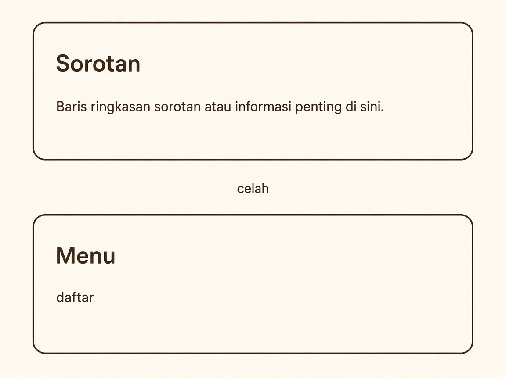
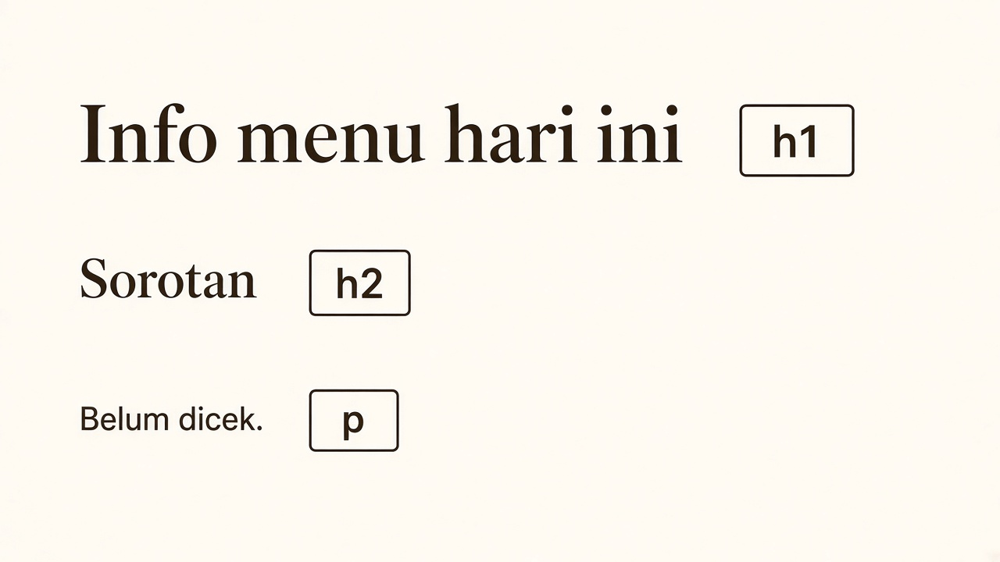
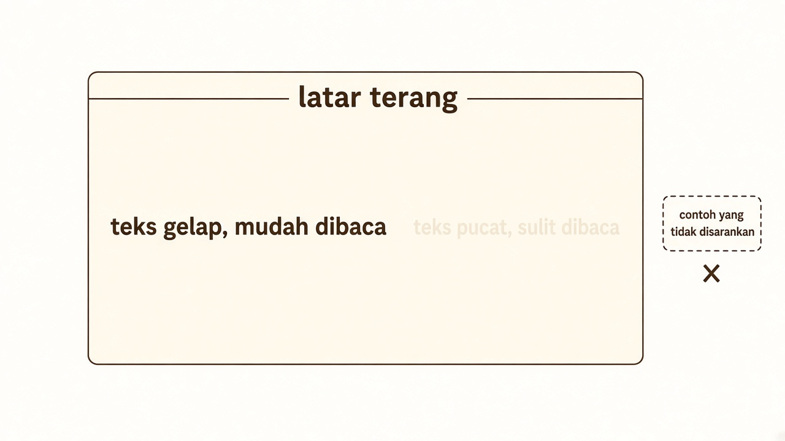
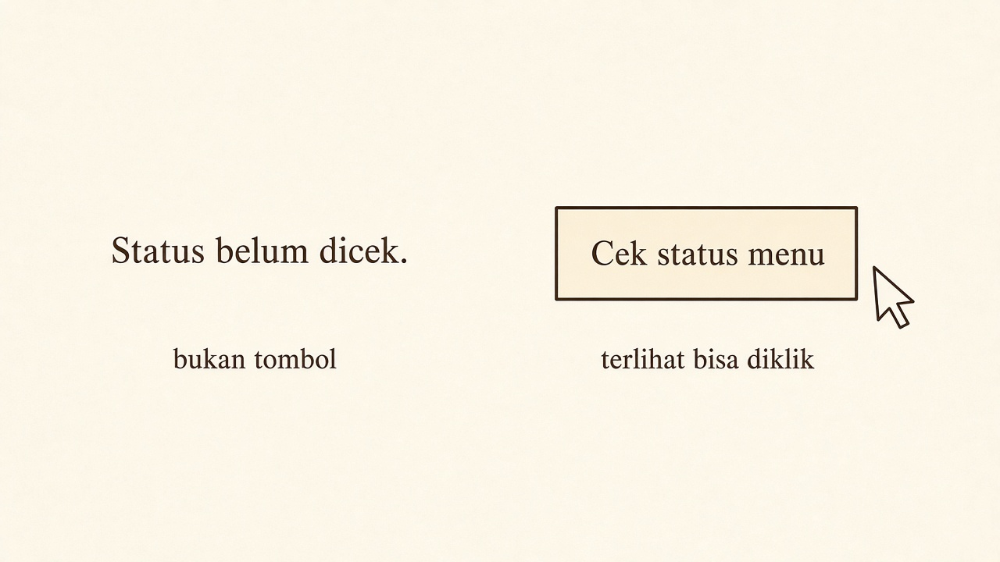
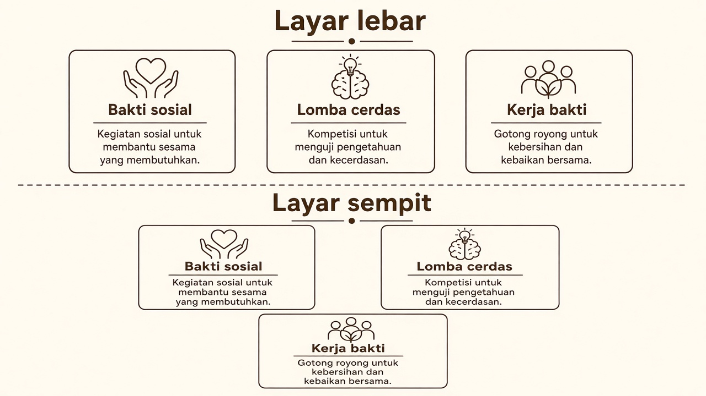
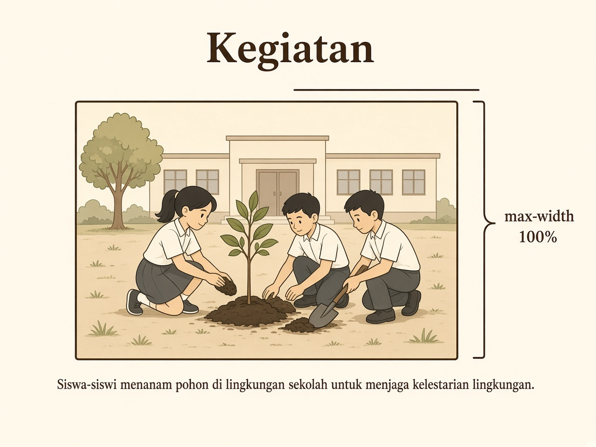

# Panduan sketsa CSS — Project S1 (P25)

Bacaan ini untuk `style.css` di folder projectmu.  
Tiap sketsa = satu keinginan visual + CSS yang menghasilkan gambar itu + elemen tempat menempelkannya.

## Dua lapis

| Lapis | Isi | Wajib untuk lulus AC keterbacaan |
|---|---|---|
| Minimum spek | Sketsa 1–6 | Ya. Ini yang kamu janjikan di AC 4 saat kickoff |
| Eksplorasi | Sketsa 7 (flex) dan sketsa 8 (gambar) | Tidak. Kerjakan kalau daftar atau gambar memang ada di halamanmu, dan kamu bisa menunjukkan hasilnya di browser |

AC 4 tetap: lebar baris dibatasi, section tidak menempel, judul lebih besar dari paragraf, teks kontras, tombol terlihat tombol.  
`id` dari P23 tidak diganti. `script.js` belum diisi hari ini.

Urutan tempel di `style.css`: sketsa 1, lalu 2, 3, 4, 5, 6. Flex dan gambar di bawahnya, kalau dipakai.

---

## 1. Kolom di tengah, dan tetap muat di layar sempit

Keinginan: isi halaman tidak melebar seisi monitor. Di layar lebar, kolom duduk di tengah. Di layar sempit, kolom ikut menyempit dan tidak terpotong.



`margin: 0 auto` menarik elemen ke tengah hanya kalau lebarnya lebih kecil dari layar. `max-width` yang menghentikan pelebaran. `width: 100%` membuat kolom memakai layar saat jendela lebih sempit dari 40rem.

```css
header,
main,
footer {
  width: 100%;
  max-width: 40rem;
  margin: 0 auto;
}
```

Terapkan di `header`, `main`, dan `footer` sekaligus, supaya tiga bagian itu satu kolom. Jangan tempel di tiap `p` atau di `button`.

---

## 2. Huruf tidak menempel tepi kolom, dan tidak ada pita putih bawaan browser

Keinginan: ada udara antara tepi kolom dan huruf. Tepi jendela browser tidak menambah jarak liar.



```css
body {
  margin: 0;
  line-height: 1.5;
}

header,
main,
footer {
  padding: 1.25rem 1rem;
}
```

`margin: 0` diterapkan di `body`. `padding` diterapkan di `header`, `main`, dan `footer` — tambahkan di dalam aturan sketsa 1, jangan buat aturan kedua yang saling menimpa. `line-height: 1.5` di `body` mengendurkan jarak antar baris teks.

---

## 3. Dua section tidak menempel

Keinginan: setelah satu bagian selesai, ada celah sebelum judul bagian berikutnya.



```css
section {
  margin-bottom: 1.75rem;
}
```

Terapkan di `section`.

---

## 4. Judul kelihatan judul

Keinginan: mata langsung menemukan `h1`, lalu `h2`, baru paragraf.



```css
h1 {
  font-size: 1.75rem;
  line-height: 1.2;
}

h2 {
  font-size: 1.25rem;
  line-height: 1.2;
}
```

Terapkan di `h1` dan `h2`. Paragraf tidak perlu diperkecil.

---

## 5. Tulisan kebaca di atas latar

Keinginan: huruf gelap di bidang terang. Ganti kedua warna sekaligus kalau kamu ingin suasana lain. Jangan hanya mengganti salah satu sampai huruf menjadi pucat.



```css
body {
  color: #1f1a14;
  background: #f7f1e8;
  font-family: Georgia, "Times New Roman", serif;
}
```

Terapkan di `body`, digabung dengan `margin` dan `line-height` dari sketsa 2. `font-family` boleh `sans-serif` kalau kamu lebih nyaman dengan huruf tanpa kait.

---

## 6. Tombol terlihat bisa diklik

Keinginan: tombol bukan kalimat polos. Ada ruang di dalam kotak, ada garis tepi, kursor berubah saat diarahkan.



```css
button {
  font: inherit;
  padding: 0.55rem 0.9rem;
  border: 1px solid #1f1a14;
  background: #fff8ef;
  cursor: pointer;
}
```

Terapkan di `button`. Warna garis dan dasar mengikuti pasangan warna sketsa 5. Jangan menghapus garis fokus (`outline`).

---

## 7. Eksplorasi — daftar berjajar dengan flex

P09 sudah memakai flex untuk menu `nav`: anak-anak sejajar, ada celah, dan turun ke baris baru kalau layar sempit. Pola yang sama bisa dipakai pada daftar isi, misalnya tiga kegiatan kelas atau tiga menu.

Kerjakan sketsa ini hanya jika halamanmu sudah punya `ul` di dalam `section`. Jangan menambah section baru demi flex. Jangan menaruh `display: flex` di `body`.



```css
section ul {
  display: flex;
  flex-wrap: wrap;
  gap: 0.75rem;
  list-style: none;
  padding: 0;
  margin: 0;
}

section li {
  padding: 0.4rem 0.7rem;
  border: 1px solid #1f1a14;
}
```

Terapkan di `ul` yang ada di dalam `section`, dan di `li` di dalamnya. Tiga properti yang perlu bisa kamu sebut: `display: flex` membuat butir sejajar, `gap` mengatur celah, `flex-wrap: wrap` menurunkan butir saat tidak muat.

Kalau spekmu tidak punya daftar, lewati sketsa ini. AC keterbacaan tetap bisa lulus.

---

## 8. Eksplorasi — satu gambar yang ikut kolom

Satu gambar di dalam section yang sudah ada. Gambar menyempit bersama kolom, tidak mendorong halaman melebihi `max-width`.



Di HTML, di dalam section yang sudah kamu tulis di P24:

```html

```

`alt` menjelaskan isi gambar dalam satu kalimat. Ganti nama file dan kalimat `alt` sesuai fotomu. Letakkan file gambar di folder project yang sama.

```css
img {
  max-width: 100%;
  height: auto;
  display: block;
  margin: 0.75rem 0;
}
```

Terapkan di `img`. `max-width: 100%` menahan gambar agar tidak lebih lebar dari kolom. `height: auto` menjaga proporsinya. Jangan menulis lebar piksel tetap yang lebih besar dari kolom, misalnya `width: 1200px`.

Kalau spekmu tidak menyebut gambar, sketsa ini tidak wajib. Satu gambar dengan `alt` sudah cukup untuk eksplorasi. Jangan menambah galeri.

---

## Susunan `style.css` minimum

Bagian eksplorasi tidak ikut di blok ini.

```css
body {
  margin: 0;
  line-height: 1.5;
  color: #1f1a14;
  background: #f7f1e8;
  font-family: Georgia, "Times New Roman", serif;
}

header,
main,
footer {
  width: 100%;
  max-width: 40rem;
  margin: 0 auto;
  padding: 1.25rem 1rem;
}

section {
  margin-bottom: 1.75rem;
}

h1 {
  font-size: 1.75rem;
  line-height: 1.2;
}

h2 {
  font-size: 1.25rem;
  line-height: 1.2;
}

button {
  font: inherit;
  padding: 0.55rem 0.9rem;
  border: 1px solid #1f1a14;
  background: #fff8ef;
  cursor: pointer;
}
```

## Sebelum bertanya

1. Kolom di tengah belum terjadi: cek `max-width` dan `margin: 0 auto` ada pada `header`, `main`, dan `footer`.
2. Flex membuat seluruh halaman berjajar samping: `display: flex` sedang menempel di `body`. Pindahkan ke `section ul`.
3. Gambar melebar keluar kolom: ganti lebar piksel tetap dengan `max-width: 100%` dan `height: auto`.
4. `id` berubah: kembalikan ke tabel alamat di `spek.md`.
