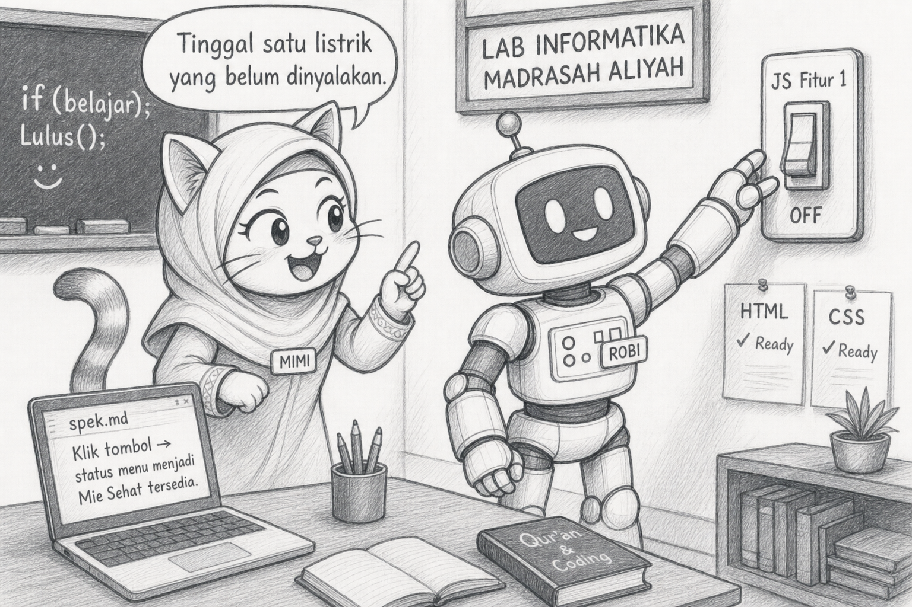
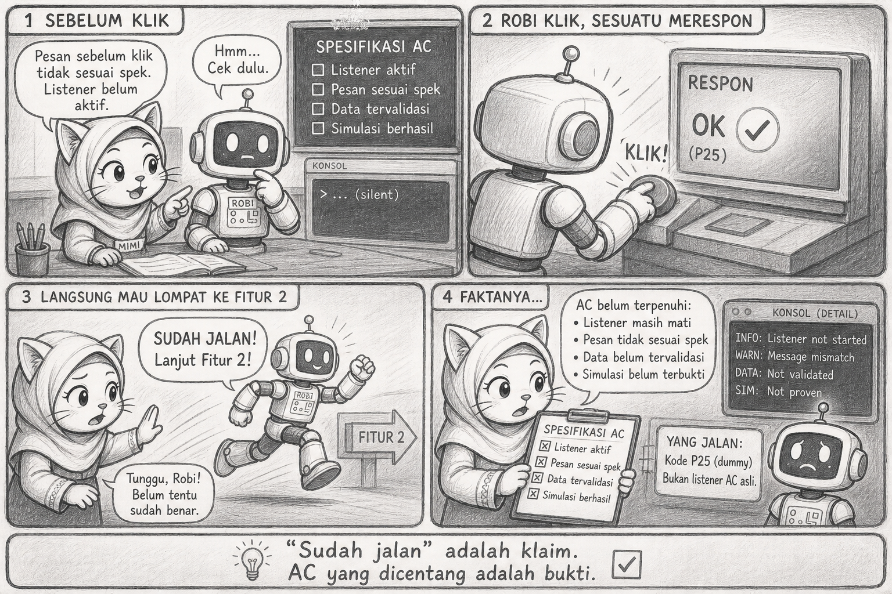

# Bacaan Pendamping — X-S1-P26
## Mimi & Robi: Tombol yang Akhirnya Menepati Janji, `null` yang Kembali Berkunjung, & "Sudah Jalan" Tanpa AC

| Field | Isi |
|---|---|
| Kode | X-S1-P26 — JS Fitur 1 |
| Pertemuan | **26 / 34** · Basis **4JP** |
| Status | Naskah humor · **3 sketch khusus JS Fitur 1** · Mimi syari (standar project) |

**Handout:** [X-S1-P26_project-s1-js-fitur1_siswa.md](./X-S1-P26_project-s1-js-fitur1_siswa.md)

---

Halo. Mimi.

P23 Robi menulis di `spek.md`:

> "Klik tombol → status menu berubah menjadi `'Mie Sehat tersedia'`."

Tiga pertemuan kemudian, halamannya sudah ada. CSS-nya bernapas. Tinggal satu listrik yang belum dinyalakan.



## Learning Compass

| Arah | Hari ini |
|---|---|
| Tujuan | Satu listener dari spek → AC lulus |
| Bukti | Sebelum klik · sesudah klik · konsol |
| Bukan | Fitur 2 · elemen baru · CSS ulang |

## Adegan 1 — `id` yang pindah rumah lagi

Robi membuka `script.js`. Menulis:

```javascript
const tombol = document.getElementById("btnUtama");
```

`null`.

Aku menunjuk `spek.md`. `tombolUtama`. Bukan `btnUtama`.

> "Kan sama maksudnya."

> "Komputer bukan pembaca pikiran. Ia membaca huruf."

Satu nama. Satu alamat. Jangan dua nama untuk satu pintu.


## Plot twist — "sudah jalan"

Listener terpasang. Klik. Ada reaksi.

Robi langsung mau maju ke fitur 2.

Aku: "AC sebelum klik?"

Ternyata teks awal sudah berubah dari yang dijanjikan spek. Konsol pun tidak menulis apa-apa — listener tidak terpasang, yang jalan adalah kode lama P25 yang tidak dihapus.

> "Sudah jalan" adalah klaim. AC yang dicentang adalah bukti.



## Adegan 2 — trace singkat

```text
Sebelum klik : "Belum dicek. Klik tombol untuk status menu utama."
Klik         : listener terpicu
Setelah klik : "Mie Sehat tersedia."
Konsol       : "Fitur 1: pesan diperbarui."
```

Empat baris. Dapat ditunjuk ke peer. Tidak bisa diklaim tanpa dicek.

## Reflect

Fitur 1 bukan P21. P21 adalah latihan dasar. P26 adalah janji kepada spek yang ditulis tiga minggu lalu. Beda konteks, beda tanggung jawab.

## Exit

1. `id` yang dipakai: …  
2. Teks sebelum dan sesudah klik: …  
3. Satu debug yang ditemukan: …

> **Listener dari spek adalah janji yang sekarang bisa diuji — bukan fitur yang diklaim selesai.**

— **Mimi** 🐾

- Ilustrasi: `assets/mimi-robi/p26-01` … `p26-03` (`.jpg`)
- Visual Mimi: baju syari (metafora CSS project) — berlanjut P27+
