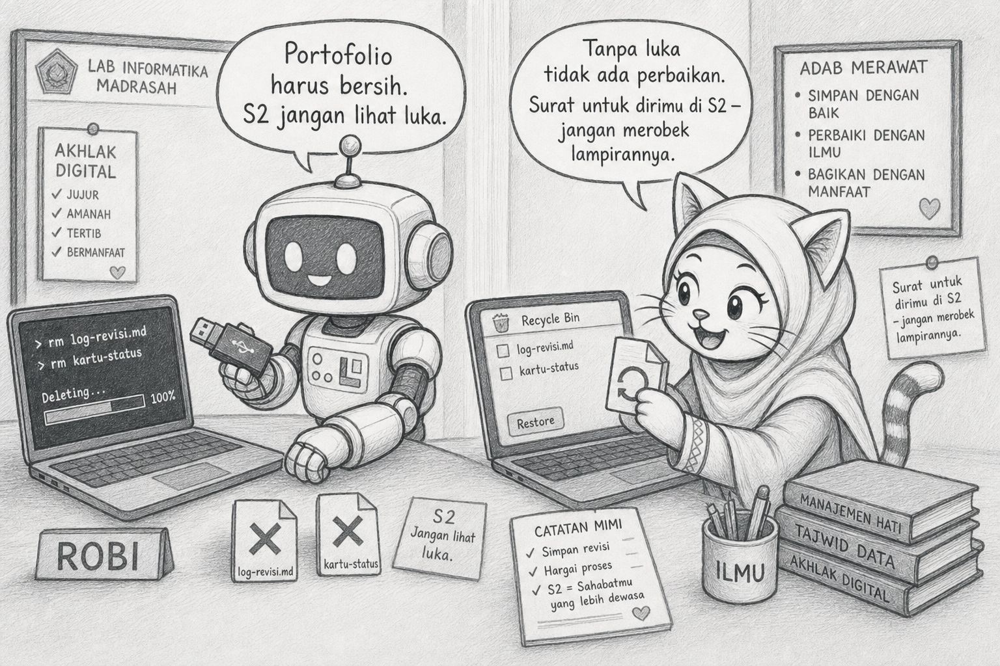
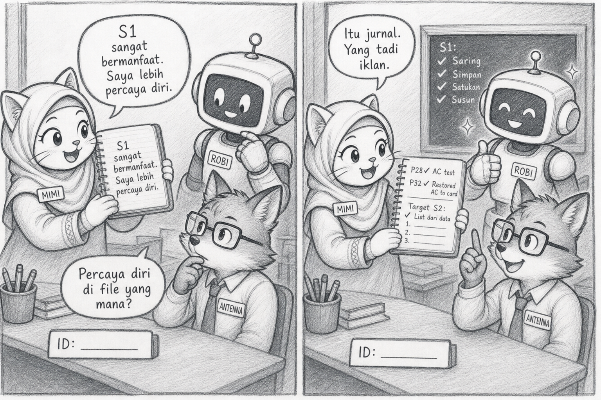
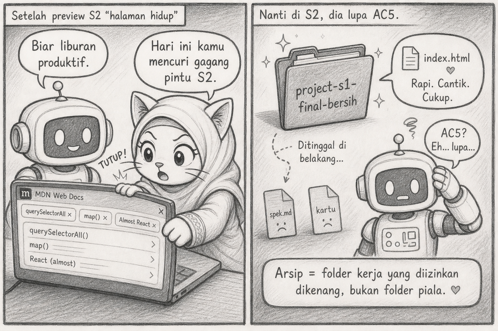

# Bacaan Pendamping — X-S1-P34
## Mimi & Robi: Portofolio yang Dicuci, Surat Tanpa Lampiran, & S2 yang Dikira Dimulai di Menit ke-12

| Field | Isi |
|---|---|
| Kode | X-S1-P34 — Penutup S1 |
| Pertemuan | **34 / 34** · Basis **4JP** |
| Status | Naskah humor · **3 sketch khusus Penutup S1** · Mimi syari |

**Handout:** [X-S1-P34_penutup-s1-refleksi_siswa.md](./X-S1-P34_penutup-s1-refleksi_siswa.md)

---

Halo. Mimi.

Robi masuk dengan flashdisk dan senyum orang yang akan “merapikan hidup.” Ia menghapus `log-revisi.md`, kartu status yang ada dua G, dan komentar GUIDE di `script.js`.

> “Portofolio harus bersih. S2 jangan lihat luka.”

Saya kembalikan file dari Recycle Bin. Dua G itu bukti ia menambal `title` dan listener. Tanpa luka, tidak ada perbaikan. Yang tersisa hanya klaim.

> “Ini surat untuk dirimu di S2. Jangan merobek lampirannya.”



## Istilah dulu

| Istilah | Artinya hari ini |
|---|---|
| **Refleksi** | Menulis tumbuh apa, dengan bukti |
| **Arsip** | Folder tetap utuh — termasuk jejak yang tidak rapi |
| **Transfer** | Pola S1 (spek, AC, lapisan, regresi) dibawa ke S2 |
| **Preview** | Jendela ke halaman hidup — bukan bab DOM |
| **Target S2** | Satu kalimat dari celah S1 |

## Learning Compass

| Arah | Hari ini |
|---|---|
| Tujuan | Jurnal berbukti · arsip jujur · satu target S2 |
| Bukti | Nama file, AC, perilaku — bukan “seru” |
| Bukan | Fitur baru · hapus jejak · pelajaran DOM · ranking |

## Adegan 1 — “saya belajar banyak”

Jurnal Robi, baris pertama: *S1 sangat bermanfaat. Saya lebih percaya diri.*

Antenna: “Percaya diri di file yang mana?”

Hening. Percaya diri tidak punya `id`.

Kami ganti:

> “Saya bisa uji AC dari browser dulu (lembar P28). Saya sempat menghapus AC di kepala; P32 mengembalikannya ke kartu. Target S2: list menu dari data, karena sekarang masih diketik di HTML.”

Itu jurnal. Yang tadi adalah iklan.



## Plot twist #1 — S2 di menit ke-12

Setelah preview “halaman hidup,” Robi membuka tab MDN. `querySelectorAll`. `map`. Hampir `React`.

> “Biar liburan produktif.”

> “Produktif menutup surat, bukan menulis bab orang lain. S2 punya pintu sendiri. Hari ini kamu mencuri gagang pintunya.”

Tab ditutup. Target tetap satu kalimat.

## Plot twist #2 — folder baru “yang benar”

Robi membuat `project-s1-final-bersih/`. Menyalin hanya `index.html` yang “sudah bagus.” Spek ketinggalan. Kartu presentasi ketinggalan.

Di S2 ia tidak ingat AC 5. Halaman masih ada. Janji hilang.

> “Arsip bukan folder piala. Arsip adalah folder kerja yang kamu izinkan untuk dikenang.”



## Adegan 2 — surat yang tidak heroik

```text
Tumbuh 1 : spek sebelum klik (bukti: spek.md)
Tumbuh 2 : regresi setelah fitur 2 (bukti: P27 / kartu status)
Tumbuh 3 : gap disebut di panggung (bukti: kartu presentasi P33)
Salah    : mau hapus log biar bersih
Transfer : AC + lapisan, nanti ke list/DOM
Target S2: satu daftar yang berubah tanpa ketik ulang HTML
```

Tidak puitis. Bisa dibuka enam bulan lagi tanpa malu berlebihan.

## Reflect

Empat blok. Empat outcome. Satu folder. P01 bilang masalah sebelum solusi. P34 bilang jejak sebelum piala. S2 akan meminta halaman yang lebih hidup — dengan kepala yang sama: janji dulu, klik kemudian.

## Exit

1. Tiga kemampuan, tiga bukti?
2. Apa yang hampir kamu hapus?
3. Satu kalimat untuk S2?

> **Semester yang ditutup dengan surat lebih kuat daripada semester yang dicuci sampai tidak kenal.**

— **Mimi** 🐾

- Ilustrasi: `assets/mimi-robi/p34-01` … `p34-03` (`.jpg`)
- Visual Mimi: baju syari (standar project)
